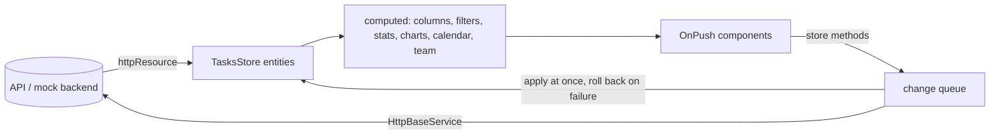

# Task Management Dashboard

[](https://github.com/AbdulrhmanSamir3579/task-management-dashboard/actions/workflows/ci.yml)
[](https://abdulrhmansamir3579.github.io/task-management-dashboard/)

A task management dashboard built with Angular 22: a drag-and-drop Kanban board, task create and edit with validation, inline editing, search and filters, statistics and charts, a calendar, a team page, an activity feed, Arabic and English with right-to-left layout, and dark mode.

**Live demo:** <https://abdulrhmansamir3579.github.io/task-management-dashboard/>

## Contents

- [Features](#features)
- [Tech stack](#tech-stack)
- [Getting started](#getting-started)
- [Environment configuration](#environment-configuration)
- [Scripts](#scripts)
- [Project structure](#project-structure)
- [Architecture](#architecture)
- [Key decisions](#key-decisions)
- [Design patterns](#design-patterns)
- [Testing](#testing)
- [Performance](#performance)
- [Accessibility](#accessibility)
- [CI/CD and deployment](#cicd-and-deployment)
- [Development practices](#development-practices)
- [Known limitations](#known-limitations)
- [Future improvements](#future-improvements)
- [Mock data](#mock-data)

## Features

| Area             | What it does                                                                                                                                                                                                         |
| ---------------- | -------------------------------------------------------------------------------------------------------------------------------------------------------------------------------------------------------------------- |
| Board            | Three columns (To Do, In Progress, Done) with drag and drop within and between columns, a "Move to" menu as the keyboard alternative, and feedback on every card while it saves                                      |
| Tasks            | Create, edit and delete. Edit in a dialog, or inline on the card: title, priority and assignee                                                                                                                       |
| Form             | Typed reactive form with custom validators (not blank, unique title checked as you type, dates, list limits), a dynamic checklist, a completion date that appears for done tasks, and a prompt before losing changes |
| Search & filters | Header search with suggestions; status tabs, priority and assignee filters; filters are kept in the URL                                                                                                              |
| Statistics       | Stat cards computed from the tasks, and charts by status, priority, workload and trend on the Analytics page                                                                                                         |
| Calendar         | Month, week and agenda views of due dates                                                                                                                                                                            |
| Team & activity  | Team members with their task counts; an activity feed of recent changes                                                                                                                                              |
| Languages        | English and Arabic, switched instantly, with right-to-left layout, Arabic plural forms and localized dates                                                                                                           |
| Themes           | Light, dark, or follow the device                                                                                                                                                                                    |
| Resilience       | Loading skeletons, error states with retry, automatic retries for failed reads, and a failure mode for demos (`?chaos=0.3`)                                                                                          |

## Tech stack

| Concern         | Choice                                                                    |
| --------------- | ------------------------------------------------------------------------- |
| Framework       | Angular 22: standalone components, signals, zoneless, OnPush, strict mode |
| State           | NgRx SignalStore (`@ngrx/signals`) with `httpResource` for loading data   |
| UI kit          | PrimeNG 22, used only through our own wrapper components                  |
| Drag and drop   | Angular CDK                                                               |
| Charts          | ECharts 6 with `ngx-echarts`, loaded lazily                               |
| i18n            | ngx-translate 18                                                          |
| Mock backend    | `angular-in-memory-web-api`, running in the browser                       |
| Tests           | Vitest through the Angular CLI, Angular Testing Library, axe-core         |
| Quality         | ESLint (`angular-eslint`), Prettier, Husky, lint-staged, commitlint       |
| CI/CD & hosting | GitHub Actions and GitHub Pages                                           |

## Getting started

**Prerequisites:** Node.js 24 LTS (see `.nvmrc`; Node 22 and 26 also work) and npm.

```bash
git clone https://github.com/AbdulrhmanSamir3579/task-management-dashboard.git
cd task-management-dashboard
npm install
npm start
```

Open <http://localhost:4200>. No backend or API key is needed: the mock API runs in the browser.

## Environment configuration

There are no `.env` files or environment variables. Everything runs locally out of the box.

| Setting                    | Where                                                             | Default                       |
| -------------------------- | ----------------------------------------------------------------- | ----------------------------- |
| API base URL               | `API_BASE_URL` token in `src/app/core/http/http-base.service.ts`  | `api`                         |
| Mock latency               | `provideMockApi()` in `src/app/core/mock-api/provide-mock-api.ts` | 400 ms                        |
| Simulated failures         | URL parameter, e.g. `?chaos=0.3` fails 30% of API requests        | off                           |
| Base path for GitHub Pages | `npm run build:pages`                                             | `/task-management-dashboard/` |
| Language and theme         | Header and Settings; saved in `localStorage`                      | English, follow the device    |

**Using a real API:** remove `provideMockApi()` from `app.config.ts` and provide the server's address with `{ provide: API_BASE_URL, useValue: 'https://api.example.com' }`. The endpoints and response shapes are described in [DATA_README.md](DATA_README.md); responses go through the same mappers and interceptors, so nothing else changes.

## Scripts

| Command                 | What it does                                                             |
| ----------------------- | ------------------------------------------------------------------------ |
| `npm start`             | Development server at `localhost:4200`                                   |
| `npm run build`         | Production build in `dist/`                                              |
| `npm run build:pages`   | Production build for GitHub Pages (base path, deep-link pages, 404)      |
| `npm test`              | Unit tests in watch mode                                                 |
| `npm run test:ci`       | Unit tests once, with coverage and the 80% threshold                     |
| `npm run lint`          | ESLint, then the translation check                                       |
| `npm run i18n:check`    | Fails on unknown translation keys or text written directly in a template |
| `npm run format`        | Format everything with Prettier (`format:check` only checks)             |
| `npm run smoke`         | Starts the production build in a headless DOM and checks it renders      |
| `npm run lighthouse`    | Lighthouse audits, desktop and mobile (run after a build)                |
| `npm run data:generate` | Regenerates the mock data with dates relative to today                   |

## Project structure

```text
src/app/
├── core/          App-wide services, loaded once
│   ├── http/          HttpBaseService (the only HTTP entry point), interceptors, ApiError
│   ├── mock-api/      In-memory backend: data, latency, failure mode
│   ├── data-access/   UsersStore
│   ├── models/        Domain types and DTO → model mappers
│   ├── i18n/          LanguageService, translation files, plural and text pipes
│   ├── layout/        Shell, header, sidebar, page title strategy
│   ├── routing/       Idle preloading strategy
│   ├── storage/       Safe localStorage wrapper
│   └── theme/         Light, dark and system theme
├── shared/        Reusable building blocks, no business logic
│   ├── ui/            Wrappers around PrimeNG (ui-button, ui-select, ui-dialog, ...)
│   ├── charts/        Wrappers around ECharts (one service per chart kind, ui-chart)
│   ├── components/    Small app components (empty state)
│   ├── pipes/         Highlight, relative time
│   └── utils/         Pure functions: board order, dates, text search
└── features/      One folder per page, each lazy-loaded
    ├── dashboard/  tasks/  calendar/  analytics/  team/  activity/  settings/
    └── tasks/
        ├── data-access/   TasksStore, TasksApi, filters
        ├── components/    Board, card, filter bar, toolbar (presentational)
        ├── task-form/     Form, validators, limits
        └── task-search/   Header search
```

ESLint enforces three boundaries: `HttpClient` and `httpResource` only in `core/http`, PrimeNG only in `shared/ui`, and ECharts only in `shared/charts`.

## Architecture

### One source of truth

All pages read the same task list from `TasksStore`. Columns, filtered views, statistics, charts, the calendar and team counts are `computed()` from it, so a change made anywhere shows everywhere, without another request.



### State management

- **NgRx SignalStore** holds the state. `withEntities` keeps the tasks, `withComputed` derives views, `withMethods` is the only way to change them. Components read signals and call methods; they never call the API.
- **`httpResource`** loads data (through `HttpBaseService.resource()`), and an effect copies each successful load into the store. Reads use `httpResource`; writes use plain HTTP calls, because a resource is for reading.
- **The store is the cache.** Data loads once per session and every page shares it. An HTTP response cache was built first and removed, because two caches would disagree.

### Optimistic, race-free board changes

Moving, deleting and inline edits show at once, then save in the background:

1. The change is applied locally, using the same ordering function as the server.
2. Requests are queued and sent one at a time (`rxMethod` with `concatMap`), in the order the user made them.
3. A response only updates a card when no newer change for that card is waiting, so a slow, older response can never undo a newer move.
4. A failed change is rolled back, shown on the card and in a toast, and the board reloads from the server once the queue is empty.
5. Data that arrives while changes are waiting is discarded and loaded again afterwards.

### HTTP layer

`HttpBaseService` is the single entry point. Interceptors run in this order: **error → language → retry → backend**.

- **Language:** adds `Accept-Language`, so server messages come back in the user's language.
- **Retry:** reads only (`GET`, `HEAD`, `OPTIONS`), up to 3 times with backoff, for network errors, 429 and 5xx. Writes are never retried, so a task is never created twice.
- **Error:** turns every failure into a typed `ApiError` with a readable message. Components decide how to show it: an error state with "Try again" for a failed load, a toast for a failed action.

### UI and chart wrappers

Features never import PrimeNG or ECharts. They use our `ui-*` components and chart services with our own types. A library upgrade or swap touches one folder, and gaps in the library (missing labels, focus) are fixed once.

## Key decisions

The core choices and what they were compared with. Every decision has a short record in [docs/adr](docs/adr/README.md).

| Topic         | Chosen                            | Compared with                                        | Why                                                                                                                                                      |
| ------------- | --------------------------------- | ---------------------------------------------------- | -------------------------------------------------------------------------------------------------------------------------------------------------------- |
| State         | NgRx SignalStore + `httpResource` | Classic NgRx (store, effects); plain signal services | Covers the brief's three asks (NgRx, signals, `httpResource`) with one pattern and far less boilerplate than actions, reducers and effects               |
| i18n          | ngx-translate                     | `@angular/localize`; Transloco                       | See below                                                                                                                                                |
| UI kit        | PrimeNG behind wrappers           | Angular Material                                     | Has every component the design needs (toast, confirm, multi-select, date picker, skeleton); wrappers protect against its breaking changes between majors |
| Charts        | ECharts                           | Chart.js                                             | Donut, stacked bars and lines from one library, registered piece by piece, SVG output, and right-to-left handled through options                         |
| Mock backend  | In-memory Web API                 | JSON Server                                          | Runs in the browser, so the GitHub Pages demo works without a server, and requests still pass through the real interceptors                              |
| Board changes | Optimistic with a queue           | Wait for the server                                  | Instant feedback, without the races of firing requests in parallel                                                                                       |
| Tests         | Vitest + Testing Library          | Karma + Jasmine; Jest                                | Vitest is the Angular CLI default; Testing Library tests what the user sees, so tests survive refactors                                                  |
| Hosting       | GitHub Pages                      | Docker image                                         | A free live demo that matches the brief's optional submission step; Docker was left out on purpose                                                       |

### ngx-translate vs `@angular/localize`

|                      | `@angular/localize` (built in)                     | ngx-translate (chosen)                         |
| -------------------- | -------------------------------------------------- | ---------------------------------------------- |
| When text is applied | At build time: one build per language              | At runtime: one build, JSON files per language |
| Switching language   | Load another build (another URL), full page reload | Instantly, in place                            |
| Runtime cost         | None                                               | A lookup per text                              |
| Plurals              | ICU messages built in                              | Not built in                                   |
| Workflow             | `i18n` attributes, extracted to XLIFF files        | Keys in JSON files                             |

The header switches between English and Arabic instantly, and GitHub Pages serves one build, so runtime translation fits. ngx-translate also matches the team's other Angular projects. Its weak spots were covered: keys are typed from `en.json` (a wrong key fails to compile), `npm run i18n:check` catches unknown keys and untranslated template text in CI, plurals use `Intl.PluralRules` (all six Arabic forms), and each language file is its own lazy chunk.

## Design patterns

| Pattern                             | Where                                                                                          |
| ----------------------------------- | ---------------------------------------------------------------------------------------------- |
| Store as a facade                   | `TasksStore`, `UsersStore`: components see signals and methods, not HTTP                       |
| Smart and presentational components | `TaskBoardSection` talks to the store; `TaskBoard`, `TaskCard` only use inputs and outputs     |
| Adapter / wrapper                   | `shared/ui` (PrimeNG) and `shared/charts` (ECharts)                                            |
| Mapper                              | `core/models`: API DTOs become domain models; `isOverdue` is computed, not trusted             |
| Strategy                            | `AppTitleStrategy` (translated tab titles), `IdlePreloadingStrategy` (preload pages when idle) |
| Queue                               | The board change queue in `TasksStore`                                                         |
| ControlValueAccessor base class     | `UiFormControl`: every form wrapper works with Reactive Forms                                  |
| Pure functions                      | Filtering, board order, statistics, calendar grouping: easy to test, no Angular needed         |

## Testing

```bash
npm test           # watch mode
npm run test:ci    # once, with coverage
```

**580+ tests, about 98% coverage** (statements, lines and functions; 95% branches). CI fails below 80% on any of them.

| Level               | Tools                                | What is tested                                                       |
| ------------------- | ------------------------------------ | -------------------------------------------------------------------- |
| Pure functions      | Vitest                               | Filters, board order, dates, statistics, validators, mappers         |
| Stores and services | Vitest, `HttpTestingController`      | Loading, errors, optimistic changes, rollback, the queue's ordering  |
| Components          | Angular Testing Library, user-event  | What the user sees and does: roles, labels, clicks, typing, keyboard |
| Accessibility       | axe-core                             | Pages and components have no automatic violations                    |
| Arabic              | A test helper that renders in Arabic | Right-to-left texts and plural forms                                 |
| Production build    | `npm run smoke`                      | The built app starts and renders under its GitHub Pages base path    |

Shared test helpers live in `src/testing/` (data builders, providers, the axe check, the Arabic setup).

### Trying it by hand

| To see               | Do this                                                                               |
| -------------------- | ------------------------------------------------------------------------------------- |
| Optimistic updates   | Drag a card to another column: it moves at once, then flashes green when saved        |
| Rollback             | Open the app with `?chaos=0.3`, then move cards: some fail, go back and show an error |
| Load error and retry | Open the app with `?chaos=1`: retries run, then an error state with "Try again"       |
| Inline editing       | Hover a card and press ✏️, or click the priority chip or the avatar                   |
| Validation           | Create a task with only spaces, a past due date, or another task's title              |
| Arabic               | Press "العربية" in the header: the layout, charts and plurals switch                  |
| Keyboard only        | Tab through the board and use a card's ⋮ menu to move it                              |

## Performance

- Every page is lazy-loaded and preloaded in the background once the browser is idle.
- `@defer` keeps work out of the first load: the task dialog and confirm dialog load when first needed; the header search, activity bell and toasts right after first paint.
- Card menus are created on first click, so a board renders light native buttons.
- ECharts is a separate chunk, loaded with the first chart.
- Zoneless change detection and OnPush everywhere; `@for` with `track`.
- `Intl` instead of `DatePipe`, to keep locale data out of the bundle.
- RxJS subscriptions end with `takeUntilDestroyed`; stale searches are cancelled by `switchMap`.
- Bundle budgets in `angular.json` fail the build if the initial bundle grows too much.

**Lighthouse** (CI workflow, median of 3 runs): desktop performance 98 on Dashboard, Tasks and Analytics. PageSpeed Insights on the live site: Accessibility, Best Practices and SEO 100.

## Accessibility

Semantic landmarks and headings, a skip link, visible focus, keyboard alternatives for drag and drop, accessible names on every icon button, focus returned after inline edits, text colours chosen for contrast, charts with a hidden data table for screen readers, and support for reduced motion. axe runs in the unit tests.

## CI/CD and deployment

- **On every pull request** ([ci.yml](.github/workflows/ci.yml)), one job: install, lint and translation check, format check, tests with the coverage threshold, the GitHub Pages build and the smoke test.
- **On merge to `main`:** the same checks, then deployment to GitHub Pages from the build the check made.
- **Lighthouse** ([lighthouse.yml](.github/workflows/lighthouse.yml)) runs on demand from the Actions tab.
- GitHub Pages has no server-side routing, so `build:pages` writes a copy of the app for each page (`tasks.html`, ...) and a `404.html`: deep links load directly with a 200 status.

## Development practices

- **Commits:** [Conventional Commits](https://www.conventionalcommits.org/), checked by commitlint (`feat(tasks): ...`, `fix(ui): ...`).
- **Before each commit:** Husky runs lint-staged (ESLint with fixes, Prettier) on the staged files.
- **Pull requests:** one focused change per pull request, CI green before review, merge commits so every commit stays in the history.
- **Decisions:** every architecture decision gets a short record in `docs/adr/` in the same pull request.
- **Code:** strict TypeScript and strict templates; `inject()`, `input()`, `output()`, signals and the new control flow; no PrimeNG, ECharts or `HttpClient` outside their folders.
- **Text:** every user-facing string is in both `en.json` and `ar.json`; CSS uses logical properties so right-to-left works without overrides.

## Known limitations

- **Mock data resets on reload.** The in-memory backend lives in the page; a refresh starts from the seed again.
- **No server-side rendering.** On a throttled mobile connection, the Tasks page shows its content after about 5 seconds, mostly client-side rendering plus the 400 ms simulated latency.
- **Data is not translated.** Task titles, descriptions, tags and names stay as entered.
- **No authentication**, since there is no real backend.
- **Reordering within a column is not logged** in the activity feed; moves between columns are.
- **GitHub Pages sets a 10-minute cache lifetime** on assets, which can't be changed there.
- **No end-to-end tests.** Flows are covered by component and store tests.

## Future improvements

- **Real API:** swap the mock as described in [Environment configuration](#environment-configuration), and add an auth interceptor.
- **Real-time updates:** feed server-sent events or WebSocket messages into the store's methods; every computed view (columns, statistics, charts, calendar) updates by itself. Events for cards with changes still waiting would be reconciled by version.
- **Server-side rendering or prerendering** with hydration, for a faster first paint on mobile. Browser APIs are already reached through `DOCUMENT` and a storage wrapper, which keeps that move small.
- **Signal Forms** for the task form, once the team adopts them.
- **Virtual scrolling** for very large columns, and a service worker for offline use.
- **End-to-end tests** with Playwright for the main flows.

## Mock data

The mock API is seeded from the JSON files in `data-fetching/`. To regenerate them with dates relative to today:

```bash
npm run data:generate
```

See [DATA_README.md](DATA_README.md) for the data contract.
