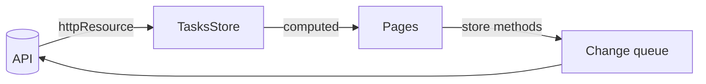

# Task Management Dashboard

[](https://github.com/AbdulrhmanSamir3579/task-management-dashboard/actions/workflows/ci.yml)
[](https://abdulrhmansamir3579.github.io/task-management-dashboard/)

A task management dashboard built with Angular 22, NgRx SignalStore and PrimeNG.

**Live demo:** <https://abdulrhmansamir3579.github.io/task-management-dashboard/>

## Features

- **Kanban board** with drag and drop within and between columns, and a keyboard alternative
- **Tasks:** create, edit and delete in a dialog, or edit the title, priority and assignee right on the card
- **Form** with custom and async validators, a dynamic checklist and an unsaved-changes prompt
- **Search** with suggestions; filters by status, priority and assignee, kept in the URL
- **Statistics and charts**, calendar (month, week, agenda), team page and activity feed
- **English and Arabic** with right-to-left layout; light and dark themes
- **Optimistic updates** with rollback, loading skeletons, error states and automatic retries

## Getting started

Requires Node.js 24 LTS (see `.nvmrc`; 22 and 26 also work).

```bash
npm install
npm start          # http://localhost:4200
```

No backend is needed: the mock API runs in the browser.

## Environment configuration

There are no environment variables. A few things can be adjusted:

- **Simulated failures:** add `?chaos=0.3` to the URL to fail 30% of API requests and see retries and rollbacks.
- **Real API:** remove `provideMockApi()` from `app.config.ts` and provide `API_BASE_URL` with the server's address.
- **GitHub Pages:** `npm run build:pages` builds for the `/task-management-dashboard/` base path.

## Scripts

| Command                 | What it does                                           |
| ----------------------- | ------------------------------------------------------ |
| `npm start`             | Development server                                     |
| `npm run build`         | Production build                                       |
| `npm run build:pages`   | Production build for GitHub Pages                      |
| `npm test`              | Unit tests in watch mode                               |
| `npm run test:ci`       | Unit tests once, with coverage (fails below 80%)       |
| `npm run lint`          | ESLint and the translation check                       |
| `npm run format`        | Prettier                                               |
| `npm run smoke`         | Checks that the production build starts                |
| `npm run lighthouse`    | Lighthouse audits (after a build)                      |
| `npm run data:generate` | Regenerates the mock data with dates relative to today |

## Project structure

```text
src/app/
├── core/       App-wide: HTTP layer, mock API, i18n, layout, theme, storage
├── shared/     Reusable: PrimeNG wrappers (ui), ECharts wrappers (charts), utils, pipes
└── features/   One lazy folder per page: dashboard, tasks, calendar, analytics, team, settings
```

## Architecture and state management

All pages share one task list in an **NgRx SignalStore**. It is loaded with **`httpResource`**, and everything else is `computed()` from it: board columns, filters, statistics, charts, the calendar and team counts. A change anywhere shows everywhere, without another request; the store is the cache.

Board changes (moving, deleting, inline edits) are **optimistic**: they show at once, then save through a queue that sends one request at a time, so an older response can never undo a newer change. A failed change rolls back.



PrimeNG, ECharts and `HttpClient` are only used behind wrappers, and ESLint enforces it.

## Key decisions

Six short documents explain the big decisions and what they were compared with:

| Document                                             | Covers                                                                                         |
| ---------------------------------------------------- | ---------------------------------------------------------------------------------------------- |
| [Architecture](docs/architecture.md)                 | Angular 22 setup, folders, wrapper boundaries, PrimeNG vs Angular Material, the chart layer    |
| [State and data](docs/state-and-data.md)             | SignalStore vs classic NgRx, `httpResource`, no HTTP cache, the optimistic queue, the mock API |
| [Features and UX](docs/features-and-ux.md)           | Drag and drop, inline editing, forms, search with `debounced()`, calendar, accessibility       |
| [Internationalisation](docs/i18n.md)                 | ngx-translate vs `@angular/localize`, typed keys, plurals, right to left                       |
| [Performance](docs/performance.md)                   | What loads when, measured Lighthouse results, the next step                                    |
| [Quality and delivery](docs/quality-and-delivery.md) | Testing, code quality, CI/CD, GitHub Pages                                                     |

## Testing

```bash
npm run test:ci
```

580+ tests with about 98% coverage, using **Vitest**, **Angular Testing Library** and **axe-core**. Components are tested the way people use them (by role and label), stores against a fake HTTP backend, and every page for accessibility. A smoke test starts the production build before each deployment.

To try the main flows by hand:

- Drag a card to another column: it moves at once, then flashes green when saved.
- Open the app with `?chaos=0.3` and move cards: some fail and go back.
- Press ✏️ on a card, or click its priority chip or avatar, to edit it in place.
- Press "العربية" in the header to switch to Arabic and right to left.

## Performance

Lazy pages preloaded when idle, `@defer` for everything not needed on first paint (dialogs, menus, filters, search), zoneless with OnPush, and ECharts in its own chunk. Lighthouse desktop performance is 98–99 on every page; Accessibility, Best Practices and SEO are 100. Details in [docs/performance.md](docs/performance.md).

## Known limitations

- Mock data resets on reload; there is no authentication.
- No server-side rendering, so the first paint on slow phones takes about 5 seconds.
- Task titles, descriptions and names are not translated (they are data).
- No end-to-end tests.

## Future improvements

- Connect a real API and add authentication.
- Real-time updates with server-sent events or WebSocket, feeding the same store.
- Server-side rendering or prerendering with hydration.
- Signal Forms for the task form; end-to-end tests with Playwright.

## Mock data

The mock API is seeded from `data-fetching/`; see [DATA_README.md](DATA_README.md) for the data contract.
